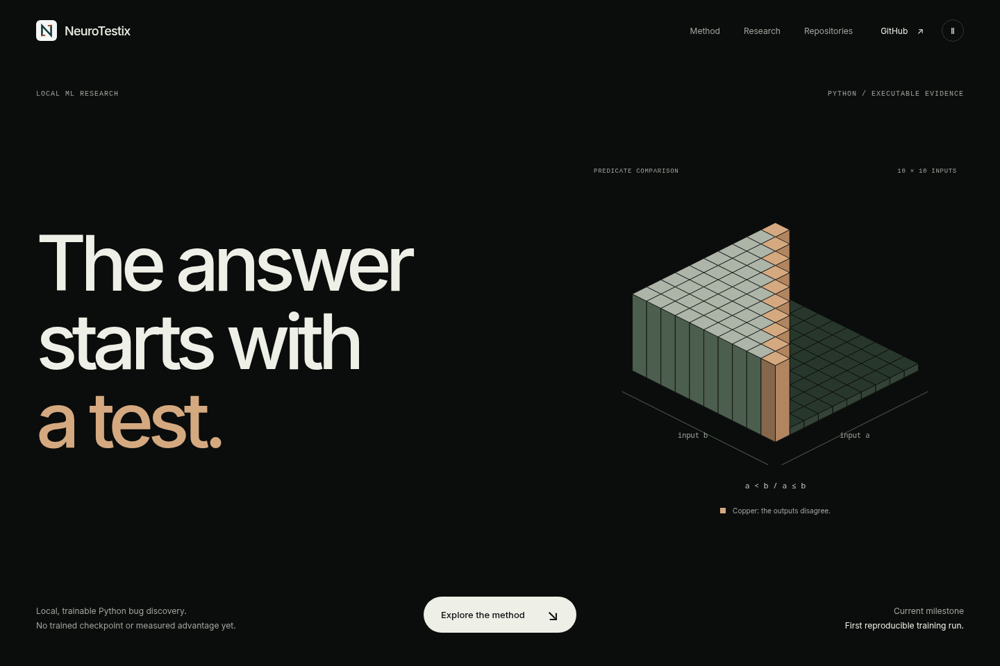
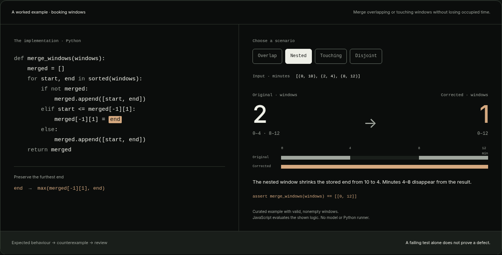

  <picture>
    <source media="(prefers-color-scheme: dark)" srcset="https://raw.githubusercontent.com/NeuroTestix/.github/main/profile/assets/logo-horizontal-dark.svg">
    
  </picture>

<h1 align="center">The answer starts with a test.</h1>

  Local-first research into trainable Python bug discovery. 
  A specific input. A reproducible counterexample. A human decision.

  <a href="https://ntx42.com/">Explore ntx42.com</a> ·
  <a href="https://ntx42.com/#method">Inspect the worked example</a> ·
  <a href="https://t.me/trufill">Talk to the maintainer</a>

## A claim you can inspect

NeuroTestix investigates whether training a compact model can make Python bug discovery more useful. The goal is a finding that comes with an input, a test and enough evidence for someone else to check it.

The proposed workflow keeps each decision explicit:

| Step | What it establishes |
| --- | --- |
| **Approve the scope** | Work starts from an approved repository snapshot. |
| **Propose a counterexample** | A model suggests a falsifiable behavior hypothesis and a minimal `pytest` test. |
| **Run independently** | A separate offline runner compares the buggy and fixed revisions. |
| **Review the evidence** | A human decides whether the observed behavior is a defect. |

## Start with a concrete example

A nested booking window can silently shorten an occupied range. A later merge then creates a gap that never existed. The website lets you change the inputs and compare both implementations on a time scale.

**This is a curated illustration.** It is evaluated in JavaScript and uses neither a model nor a Python runner. [Try the four cases on ntx42.com.](https://ntx42.com/#method)

## Research status

**Early research. No trained NeuroTestix checkpoint, measured advantage or public product release yet.**

The six core repositories — `service`, `data`, `model`, `eval`, `runtime` and `docs` — remain private while we check data rights, evaluation boundaries, runtime cost and model behavior. We intend to open-source the work after those checks.

The first technical milestone is a reproducible small-model training run. Product validation requires an evaluation on repositories held out from training, independently accepted root causes and a measured false-alert budget.

The public website explains the research direction and illustrates the intended workflow. It is not a released bug-finding service.

## Maintainer

**[Artem Malanin](https://www.linkedin.com/in/artem-malanin-3a9818420)** — founder and developer.

[Telegram @trufill](https://t.me/trufill) · [LinkedIn](https://www.linkedin.com/in/artem-malanin-3a9818420) · [ntx42.com](https://ntx42.com/)

For research discussion and project questions, contact Artem directly.
